# ShopCRM

> CRM سبک و ساده برای **مغازه‌های کوچک و فروشگاه‌های محلی**
> فروش سریع، مدیریت محصولات، گزارش‌گیری، و کنترل دسترسی کامل - همه در یک اپ سبک.

---

## 📌 وضعیت پروژه

پروژه در مرحله **Beta** قرار دارد. بخش‌های اصلی کامل و قابل استفاده‌اند، اما همچنان در حال بهبود و رفع باگ است.

ShopCRM برای فروشگاه‌های کوچک و محلی طراحی شده و در حال حاضر برنامه‌ای برای پشتیبانی از فروشگاه‌های بزرگ ندارد

- ✅ فروش تک‌قلمی و چندقلمی (فاکتور/سبد خرید)
- ✅ تخفیف در سطح هر واحد، کل ردیف کالا یا کل فاکتور
- ✅ ثبت کالاهای آزاد در فاکتور بدون تغییر موجودی انبار
- ✅ مرجوعی کامل و جزئی، حتی در چند مرحله، با تأیید فروشنده
- ✅ مدیریت محصولات با قیمت خرید، قیمت فروش، موجودی و تاریخچه تغییرات
- ✅ ثبت گردش موجودی و اصلاح دستی موجودی انبار
- ✅ مدیریت ستون‌های سفارشی (برای هر فاکتور یا هر قلم)
- ✅ گزارش و نمودار آماری
- ✅ سیستم نقش‌ها و دسترسی‌ها (Owner / Admin)
- ✅ لاگ کامل فعالیت‌ها (Audit Log)
- ✅ بک‌آپ و بازیابی
- ✅ احراز هویت با PBKDF2 + CSRF + Rate Limit
- ✅ رابط کاربری RTL فارسی + Dark Mode
- ⚠️ برای استفاده در محیط‌های چند‌کاربره‌ی حساس، ابتدا HTTPS و PostgreSQL را در نظر بگیرید

---

## 🖼️ اسکرین شات ها

### داشبورد
صفحه اصلی و دسترسی سریع به بخش‌های مختلف برنامه.

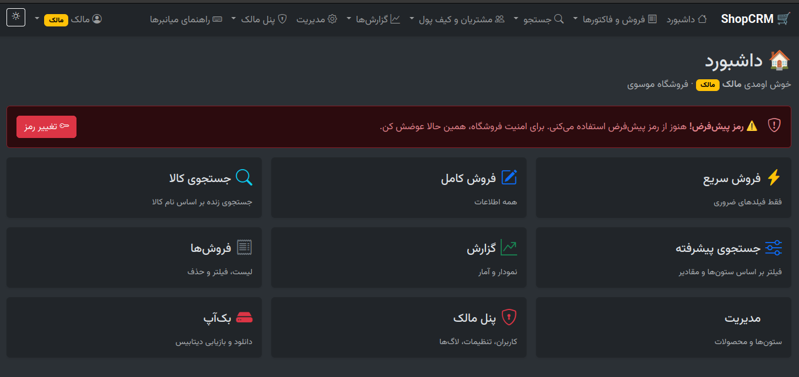

### مدیریت فاکتور ها
مشاهده فاکتورها، فیلتر فروش‌ها و دسترسی به جزئیات هر فاکتور.

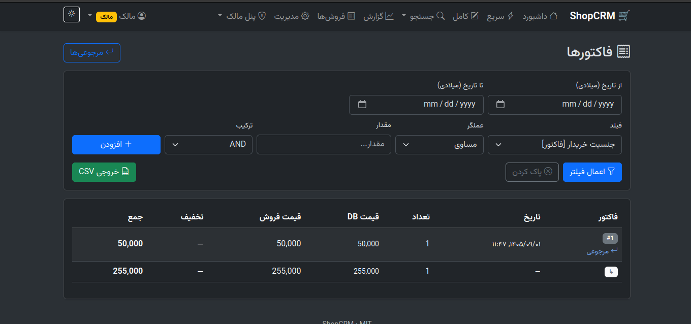

### فروش سریع
ثبت سریع فاکتور با حداقل اطلاعات موردنیاز.

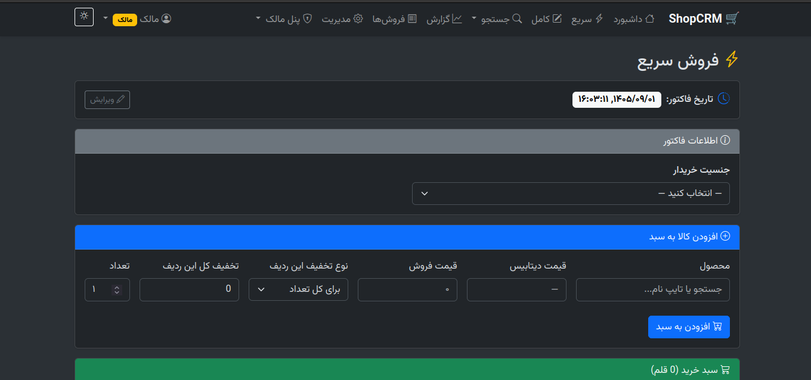
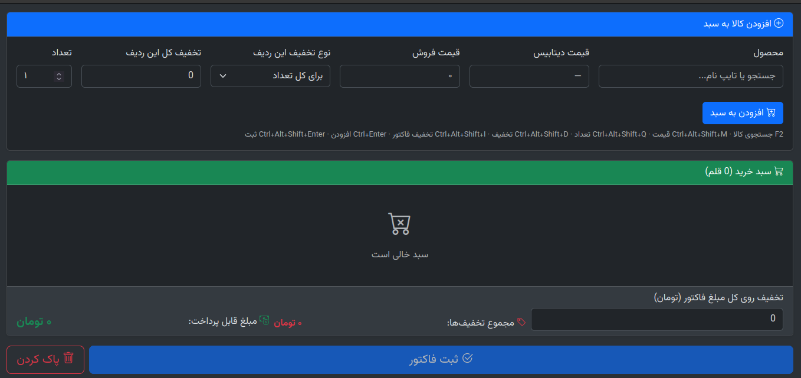

### فروش کامل
ثبت فاکتور با جزئیات کامل و امکان افزودن چند کالا.

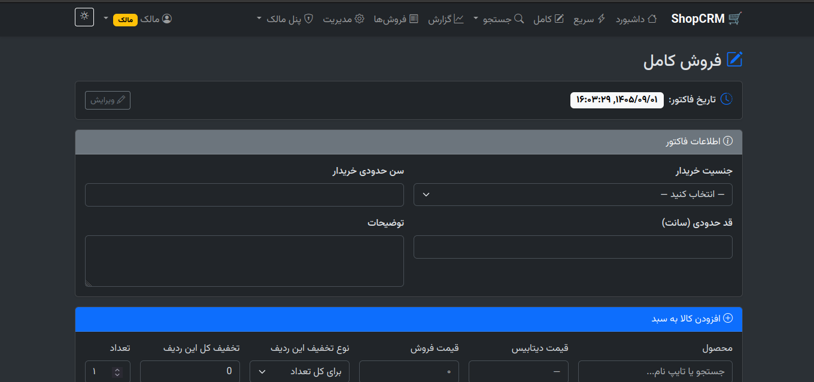
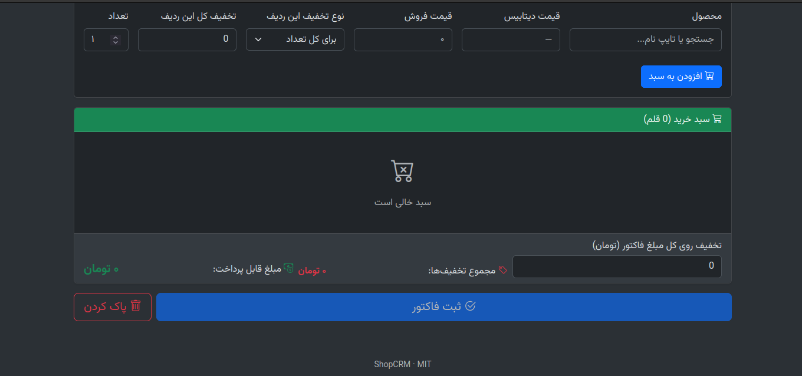

### جستجو کالا
جستجوی سریع محصولات همراه با نمایش قیمت و موجودی.

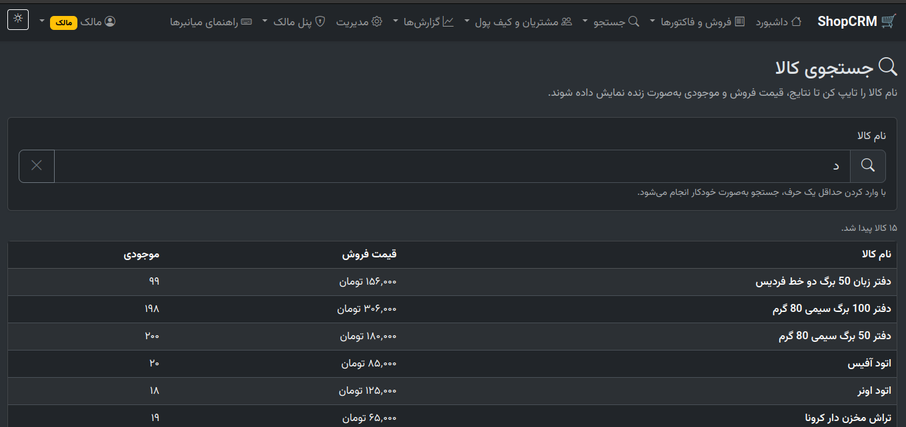

### گزارش
گزارش‌ها و نمودارهای آماری فروش.

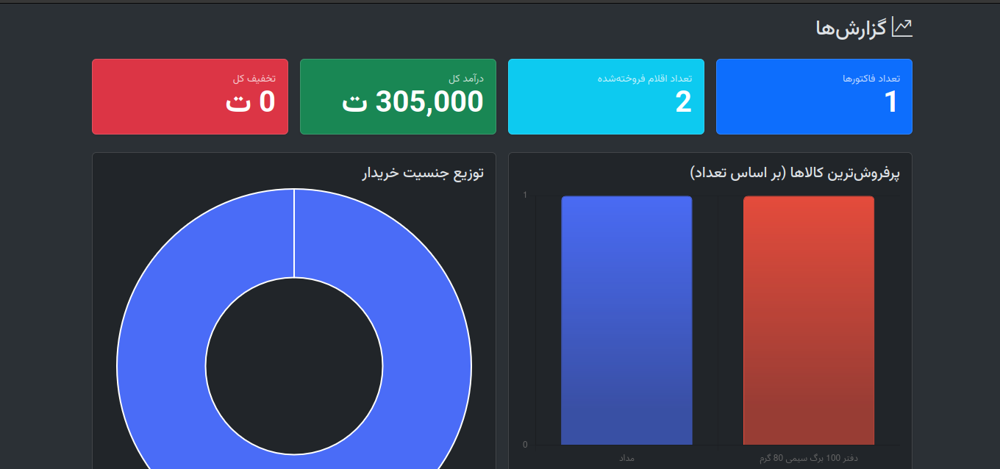

### مرجوعی
مدیریت مرجوعی فاکتورها و ثبت مرجوعی کالا.

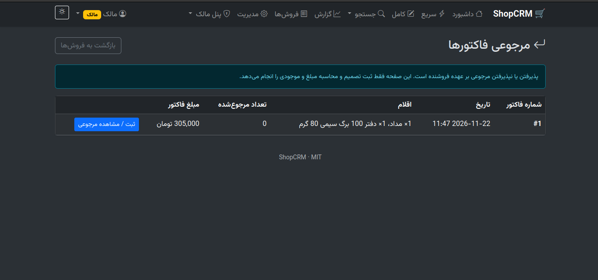
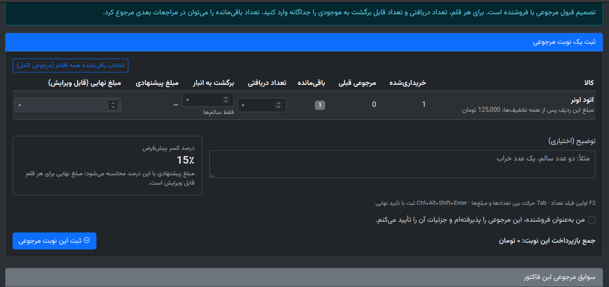

### پنل مدیریت
مدیریت محصولات، ستون‌های سفارشی و تنظیمات برنامه.

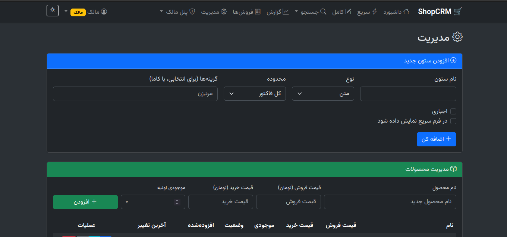
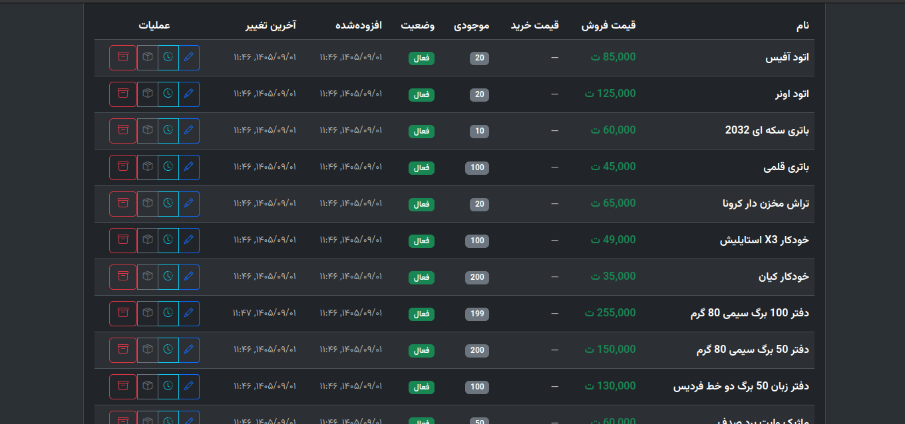
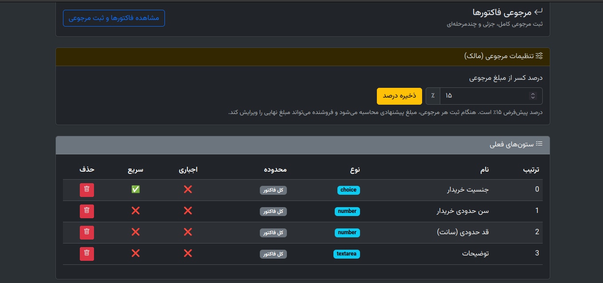

## پنل آنالیز

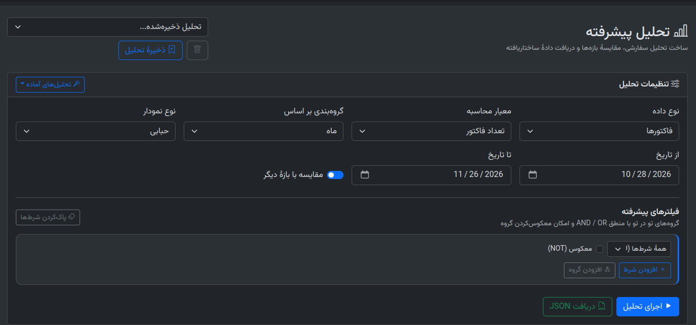

### پنل مالک
مدیریت کاربران، دسترسی‌ها و تنظیمات مالک.

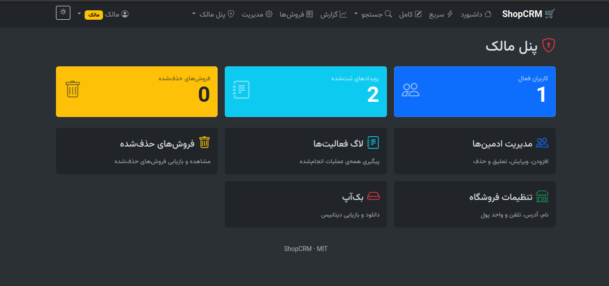

---

## 🚀 نصب و اجرا

### پیش‌نیازها
- Python 3.11 یا بالاتر
- pip

### نصب

```bash
git clone https://github.com/OandONE/ShopCRM.git
cd ShopCRM
python3 -m venv .venv
source .venv/bin/activate       # Linux/Mac
# یا: .venv\Scripts\activate    # Windows

pip install -r requirements.txt
```

### اجرا

```bash
python main.py
```

سپس مرورگر را باز کنید: **http://127.0.0.1:8000**

### اولین ورود

در اولین اجرا، یک حساب مالک (Owner) پیش‌فرض ساخته می‌شود:

| نام کاربری | رمز عبور |
|-----------|----------|
| `owner` | `owner` |

> ⚠️ **بعد از اولین ورود، رمز را از مسیر `/me/password` عوض کنید.**
> تا زمانی که رمز پیش‌فرض باشد، یک بنر قرمز هشدار در داشبورد نمایش داده می‌شود.

---

## 👥 نقش‌ها و دسترسی‌ها

### Owner (مالک)
- دسترسی کامل به همه‌ی بخش‌ها
- مدیریت کاربران (افزودن، ویرایش، تعلیق، حذف، تغییر رمز)
- مشاهده‌ی لاگ کامل فعالیت‌ها
- بازیابی فروش‌های حذف‌شده
- تنظیمات فروشگاه
- دانلود و بازیابی دیتابیس

### Admin (ادمین)
- دسترسی به بخش‌هایی که Owner برایش فعال کرده باشد
- دسترسی‌های قابل تنظیم:
  - فروش سریع / فروش کامل
  - جستجو
  - گزارش‌ها
  - لیست فروش‌ها
  - مدیریت ستون‌ها
  - مدیریت محصولات
  - مشاهده‌ی ستون‌های فعلی

**پیش‌فرض یک ادمین جدید:** فروش سریع/کامل، جستجو، مدیریت محصولات.

---

## 🛠 تکنولوژی‌ها

| لایه | فناوری |
|------|--------|
| **Backend** | FastAPI + SQLModel |
| **Database** | SQLite |
| **Frontend** | Jinja2 + Vanilla JS |
| **UI** | Bootstrap 5 (RTL) + Bootstrap Icons + Vazirmatn |
| **Charts** | Chart.js |
| **Auth** | PBKDF2-HMAC-SHA256 + Session Cookie + CSRF |

همه‌ی فایل‌های Frontend به‌صورت **لوکال** در `static/vendor/` نگه‌داری می‌شوند. نیازی به اینترنت در زمان اجرا نیست

---

## 📂 ساختار پروژه

```
ShopCRM/
├── main.py               <- اپ FastAPI (routes + منطق)
├── models.py             <- مدل‌های SQLModel
├── audit.py              <- helper ثبت لاگ
├── rate_limit.py         <- کلاس محدودکننده‌ی لاگین
├── reset_owner.py        <- اسکریپت بازیابی رمز مالک
├── requirements.txt
│
├── templates/            <- قالب‌های Jinja2
│   ├── base.html
│   ├── login.html
│   ├── index.html
│   ├── quick.html, full.html       <- فرم فروش با سبد
│   ├── _invoice_form.html          <- partial مشترک
│   ├── sales.html, sale_detail.html
│   ├── returns.html, sale_returns.html
│   ├── admin.html
│   ├── search.html, reports.html
│   ├── me_password.html
│   ├── backup.html
│   └── owner/
│       ├── dashboard.html
│       ├── users.html, user_form.html
│       ├── settings.html
│       ├── audit.html
│       └── deleted_sales.html
│
└── static/
    ├── app.js
    ├── invoice.js
    ├── style.css
    ├── fonts/             <- Vazirmatn
    └── vendor/
        ├── bootstrap/
        ├── bootstrap-icons/
        ├── chartjs/
        └── vazirmatn/
```

---

## 🧩 ویژگی‌های اصلی

### 🛒 فروش (فاکتور چندقلمی)
- افزودن چند کالا در یک فاکتور
- قیمت خودکار از دیتابیس هنگام انتخاب محصول
- قابلیت تغییر دستی قیمت (با نمایش تفاوت)
- تخفیف روی هر واحد کالا، کل تعداد یک ردیف یا کل مبلغ فاکتور
- نمایش و ثبت سهم تخفیف فاکتور روی ردیف‌ها برای محاسبات تاریخی و مرجوعی
- ثبت قیمت خریدِ زمان فروش برای گزارش سود تاریخی
- کاهش خودکار موجودی برای کالاهای ثبت‌شده؛ امکان ثبت فروش با موجودی منفی
- امکان افزودن کالای آزاد/ثبت‌نشده بدون اثر بر موجودی
- تاریخ و ساعت شمسی، قابل ویرایش
- سبد per-tab (sessionStorage)
- ادغام خودکار اقلام یکسان

### 📦 مدیریت محصولات
- افزودن / ویرایش / حذف
- تنظیم قیمت فروش و قیمت خرید
- تعیین موجودی اولیه و اصلاح دستی موجودی
- مشاهده تاریخچه گردش موجودی (ورودی، خروجی، فروش، مرجوعی و اصلاح)
- کنترل دسترسی مشاهده قیمت خرید برای ادمین‌ها
- **تاریخچه‌ی تغییرات قیمت** (کی، چه زمانی، چقدر)
- جستجوی هوشمند (autocomplete)

### ↩️ مرجوعی و بازپرداخت
- دسترسی به فهرست مرجوعی‌ها از میانبر داخل رابط کاربری و از جزئیات هر فاکتور
- ثبت مرجوعی کامل یا جزئی و چندمرحله‌ای برای هر فاکتور
- تعیین تعداد کالای دریافت‌شده و تعداد قابل بازگشت به موجودی به‌صورت جداگانه
- فقط تعداد قابل فروش دوباره به موجودی انبار اضافه می‌شود
- تأیید مرجوعی با تصمیم فروشنده انجام می‌شود
- درصد کسر از مبلغ بازپرداخت به‌صورت پیش‌فرض از تنظیمات فروشگاه خوانده می‌شود و مبلغ پیشنهادی قابل ویرایش است
- درصد کسر و مبلغ نهایی هر مرجوعی ذخیره می‌شود تا تغییر تنظیمات، سوابق قبلی را تغییر ندهد

### 📋 ستون‌های سفارشی
- افزودن ستون از نوع متن/عدد/انتخابی/متن بلند
- تعیین محدوده: **کل فاکتور** یا **هر قلم کالا**
- تعیین اجباری/اختیاری و نمایش در فرم سریع

### 📊 گزارش‌ها
- تعداد فاکتورها، اقلام، درآمد کل، تخفیف کل
- پرفروش‌ترین محصولات (نمودار ستونی رنگ‌دار)
- توزیع جنسیت خریدار (نمودار دونات)

### 📈 تحلیل پیشرفته (Advanced Analytics)
- ساخت تحلیل‌های سفارشی با فیلترهای ترکیبی AND / OR / NOT
- پشتیبانی از شرط‌های تو‌در‌تو
- انتخاب نوع نمودار
- مقایسه بازه‌های زمانی دلخواه
- تحلیل داده‌ها در بازه زمانی انتخابی
- ذخیره و بارگذاری تحلیل‌های سفارشی
- دریافت خروجی JSON برای پردازش خارجی و هوش مصنوعی

### 🔍 جستجوی پیشرفته
- فیلتر ترکیبی روی ستون‌های فاکتور و اقلام
- AND / OR / NOT
- بازه‌ی تاریخ

### 📤 خروجی CSV
- خروجی کامل فاکتورها با تمام ستون‌ها
- سازگار با Excel فارسی (BOM)

### 💾 بک‌آپ (فقط Owner)
- دانلود فایل دیتابیس
- بازیابی از فایل (با اعتبارسنجی)

### 🛡 امنیت
- رمزنگاری PBKDF2 (۲۰۰٬۰۰۰ iteration)
- Session Cookie با `HttpOnly` + `SameSite=Lax`
- CSRF Token روی همه‌ی POSTها (فرم + هدر API)
- Rate Limit لاگین (۵ تلاش / ۱۵ دقیقه)
- لاگ کامل همه‌ی عملیات مهم (ورود، فروش، ویرایش، حذف، بک‌آپ)

---

## 🔑 بازیابی رمز مالک

اگر رمز مالک را فراموش کردید:

```bash
python reset_owner.py owner رمزجدید
```

این اسکریپت:
- رمز مالک را عوض می‌کند
- تمام sessionهای فعال را باطل می‌کند

---

## ⚙️ فایل‌های سفارشی‌سازی

### تغییرات فروشگاه
از مسیر `/owner/settings`:
- نام فروشگاه
- نام مالک
- تلفن و آدرس
- واحد پول

### افزودن ستون‌های سفارشی
از مسیر `/admin` → «افزودن ستون جدید»

### افزودن محصول جدید
از مسیر `/admin` → «مدیریت محصولات» → افزودن با نام و قیمت

---

## 🧪 داده‌های تست

در اولین اجرا، ۱۰ محصول نمونه با قیمت‌های تقریبی از بازار بارگذاری می‌شوند:

| محصول | قیمت (تومان) |
|-------|--------------|
| مداد | 50٬000 |
| دفتر 50 برگ سیمی 80 گرم | 150٬000 |
| خودکار کیان | 35٬000 |
| دفتر 100 برگ سیمی 80 گرم | 255٬000 |
| تراش مخزن دار کرونا | 65٬000 |
| خودکار X3 استایلیش | 49٬000 |
| مداد فشنگی | 80٬000 |
| یدک کلاسور 100 برگ | 290٬000 |
| پاک کن کچل شو | 110٬000 |
| اتود آفیس | 85٬000 |
| اتود اونر | 125٬000 |
| مغز اتود سی کلاس | 80٬000 |
| مغز اتود کرونا | 50٬000 |
| دفتر زبان 50 برگ دو خط فردیس | 130٬000 |
| مقوا رنگی A4 بسته 10 عددی | 150٬000 |
| باتری قلمی | 45٬000 |
| باتری سکه ای 2032 | 60٬000 |
| ماژیک وایت برد صدف | 60٬000 |

قیمت‌ها فقط برای تست هستند - از پنل ادمین قابل ویرایش و حذف هستند.

---

## 🗺️ نقشه‌ی راه

### ✅ انجام شده
- [x] فروش سریع و کامل
- [x] autocomplete محصولات
- [x] مدیریت ستون‌ها
- [x] مدیریت محصولات با قیمت خرید/فروش، موجودی و تاریخچه
- [x] گردش موجودی و اصلاح دستی انبار
- [x] مرجوعی چندمرحله‌ای و جزئی با کنترل بازگشت به موجودی
- [x] تخفیف در سطح واحد، ردیف و کل فاکتور
- [x] فاکتور چندقلمی با سبد خرید
- [x] جستجوی پیشرفته
- [x] گزارش و نمودار
- [x] خروجی CSV
- [x] بک‌آپ و بازیابی
- [x] نقش‌ها و دسترسی‌ها
- [x] لاگ کامل فعالیت‌ها
- [x] بازیابی فروش‌های حذف‌شده
- [x] تاریخ شمسی و ساعت تهران
- [x] دارک‌مود
- [x] لوکال‌سازی کامل فایل‌ها (بدون CDN)
- [x] میانبرهای قراردادی صفحه‌کلید برای انجام عملیات بدون ماوس
- [x] صفحه‌ی تحلیل و نمودارهای پیشرفته (خطی / دایره‌ای / رادار با انتخاب نوع)
- [x] مقایسه‌ی دوره‌ای (این ماه vs ماه قبل و ...)
- [x] افزودن تنظیمات قابل پیکربندی
- [x] ساخت مشتری همراه با کیف پول
- [x] دسته بندی کالا
- [x] اضافه شدن قیمت کالا(درصدی و مقداری)
- [x] بهبود پرینت فاکتور

### 🔜 در دست اقدام
- [ ] خروجی Excel (xlsx)
- [ ] فروش هر ادمین

### 💡 ایده‌های آینده
- [ ] تست‌های خودکار (pytest)
- [ ] چند‌فایلی کردن پروژه (app/ + routes/ + services/)
- [ ] HTTPS production setup
- [ ] PWA (نصب روی موبایل)

---

## 🤝 مشارکت

Pull Request، Issue و گزارش باگ پذیرفته می‌شوند.

- برای گزارش باگ: Environment + مراحل بازتولید + پیام خطا
- برای فیچر جدید: توضیح کاربرد + طرح اولیه (اختیاری)

---

## 📄 لایسنس

MIT © OandONE

---

## 🙏 تشکر

- **Bootstrap** (MIT)
- **Bootstrap Icons** (MIT)
- **Chart.js** (MIT)
- **Vazirmatn** by rastikerdar (OFL-1.1)
- **FastAPI** + **SQLModel** (MIT)
